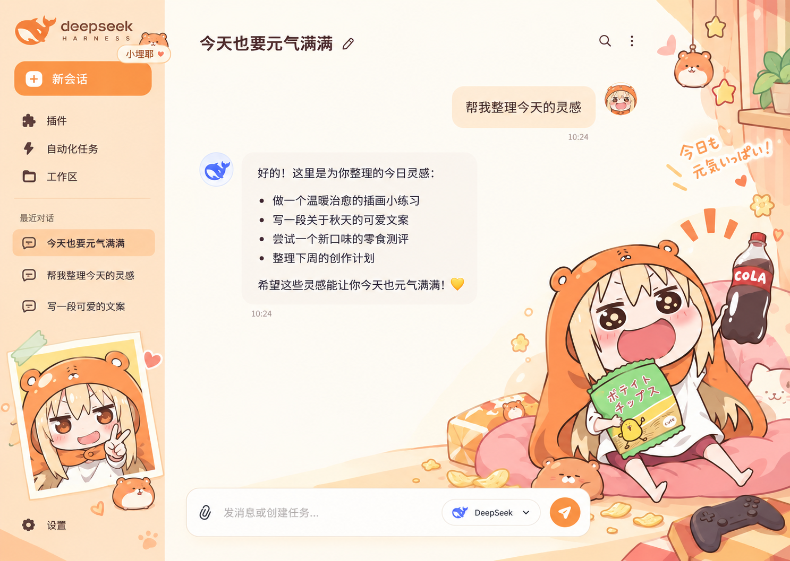

# 小埋耶

给 DeepSeek Harness 换上橘子奶油配色，把小埋的零食小窝、拍立得和仓鼠装饰放进日常聊天。

**v1.0.5** ｜ 底部遮罩修复 ｜ 保留原生侧栏拖动



> **设计参考，非实际运行截图。** 原设计基准为 1487 × 1058。实际版本沿用 DSH 原生控件与真实会话数据，并将底部输入框在居中基础上向左加长、回复气泡调整为宽版，方便日常使用。

## 最近更新

- **v1.0.5 · 底部遮罩修复**：修复聊天滚动时，文字从输入框、底部状态栏及下方留白后面透出的问题。移除主题对输入区外层透明背景的覆盖，恢复 DSH 官方渐变与不透明底部遮罩。

- **v1.0.4 · 侧栏拖动修复**：移除主题强制固定的侧边栏宽度，恢复原生拖动手柄。可拖动左侧栏的右边缘调整宽度，宽度及顶部色块跟随 DSH 原生布局。
- **v1.0.3 · 历史会话与正文显示修复**：左侧插画优先缩小，为历史列表保留空间；恢复原生消息滚动和流内输入区，避免正文区域被挤没。
- **v1.0.2 · 顶部样式调整**：窗口栏改为奶油白，补充标题编辑和搜索入口，并调整更多菜单与按钮排布。
- **v1.0.1 · 输入框加长**：利用聊天区左侧留白延伸输入框，窄窗口自动收回扩展部分。

v1.0.5 包含上述累计改进。本次修复已构建，按维护者要求未运行自动测试或界面验收，实际效果待手动检查。完整说明及安装包见 [v1.0.5 发布页](https://github.com/dingfz-cyber/dsh-theme-umaru-yeah/releases/tag/v1.0.5)。

## 主题特点

- **橘子奶油配色**：奶油白背景、暖橘色按钮与浅蜜桃聊天气泡。
- **原图装饰**：右侧小埋、零食与沙发，侧栏拍立得，以及窗帘、吊饰和仓鼠元素。
- **设计图风格顶栏**：奶油白窗口栏、标题旁的编辑入口、右侧搜索与竖向更多菜单；按钮调用原生功能，文件打开和右侧面板入口继续保留。
- **加长输入框**：会话中的底部输入框利用左侧留白向左延伸，保留右侧模型与发送按钮的位置；窄窗口中自动收回扩展部分。
- **宽版回复气泡**：回复随聊天区域伸缩，为长段落与代码提供更多横向空间。
- **侧栏拖动调宽**：使用 DSH 原生侧栏宽度与拖动手柄，拖动右边缘即可调整。
- **历史列表优先**：保留可滚动的会话区域；左侧拍立得随剩余空间缩小，矮窗口中收起，避免把旧会话挤出视野。
- **原生消息滚动**：保留 DSH 流内输入区和滚动条，避免较高的草稿、附件区重复挤压正文高度。
- **响应式装饰**：空间不足时缩小或隐藏插画；装饰不接收鼠标操作。
- **素材随包提供**：图片嵌入构建结果，显示装饰无需访问外部图片网站，安装后无需自行构建。

## 安装

### 从 GitHub 安装

1. 打开 DeepSeek Harness，在侧栏进入 **插件 → 添加插件**。
2. 粘贴下面的仓库地址，按提示完成安装。
3. 停用正在使用的其他整套界面主题，再启用 **「小埋耶」**。

```text
https://github.com/dingfz-cyber/dsh-theme-umaru-yeah
```

本仓库包含 `lib/` 构建结果和所需素材。DSH 的 Git 地址安装方式见 [官方插件管理说明](https://github.com/deepseek-ai/deepseek-harness/blob/master/packages/client/ui-plugin-manager/README.zh.md)。

### 下载 ZIP 后从本地安装

1. 打开 [最新版本下载页](https://github.com/dingfz-cyber/dsh-theme-umaru-yeah/releases/latest)，下载主题 ZIP 并解压到长期保留的位置，例如 `D:\Themes\dsh-theme-umaru-yeah`。
2. 找到直接包含 `package.json`、`cordis.patch.yml` 和 `lib/` 的文件夹。
3. 在 DSH **插件 → 添加插件** 中填写该文件夹的完整路径，安装并启用。
4. 同样先停用其他整套界面主题；如 DSH 提示需要重新加载或重启，按提示操作。

本地路径安装后请保留该文件夹，避免移动或删除。

## 使用与恢复

输入框、会话列表、模型菜单、发送与停止等操作继续使用 DSH 原生功能。真实会话文字、时间、账号、模型名称，以及原生“更多”和工作区结构保持实际数据与行为，不会替换成设计图中的示例内容。

主题以 **1487 × 1058** 为构图基准。同等可用尺寸、内容较少的短对话更接近参考图；窗口长宽比、系统标题栏、消息长度、侧栏和右侧面板状态都会影响布局，因此不承诺每个像素完全一致。

在 **插件** 中关闭「小埋耶」，会撤销本主题的样式、配色覆盖与装饰。换用其他主题时，先停用本主题再启用目标主题。需要彻底移除时使用插件管理器卸载；完成卸载及必要的重新加载后，再删除本地下载目录，无需删除聊天记录或账号配置。

## 兼容性与验证

| 项目 | 验证情况 |
| --- | --- |
| 主题版本 | 1.0.5 |
| 本次底部遮罩修复 | 已构建；按维护者要求未运行自动测试或界面验收，等待手动反馈 |
| 此前已验证环境 | Windows 桌面版 DeepSeek Harness **0.2.1-rc.3** |
| 此前已检查的界面操作 | v1.0.3 已检查主题停用/启用后的旧会话列表与消息、会话切换、消息滚动；更早版本已检查多行草稿、模型菜单、右侧面板、标题编辑、搜索及更多菜单 |
| 此前自动检查 | v1.0.3 **13 项通过**，覆盖构建与素材一致性、包入口、生命周期，以及新增按钮的命令派发、缺失能力回退和弹窗上下文等；本次未重跑 |
| 此前布局回归 | v1.0.3 Chromium 原生 CSS/DOM 结构夹具中，816 / 620 / 500 px 高窗口共 **9 种场景**通过列表可达性与正文滚动区域检查；高输入器压力场景只验证滚动区域不归零；本次未重跑 |
| 深色模式 | 提供对应配色，尚未完成全面界面验证 |
| 其他系统及 DSH 版本 | 未全面验证，更新后需重新检查适配 |

自动检查使用受限 DOM 模拟验证插件生命周期，不等同于所有窗口尺寸和操作组合的实机验证。若遇到显示异常，可先停用主题恢复原生外观。需要重启 DSH 时，请等正在运行的任务结束。

发现问题可 [提交 Issue](https://github.com/dingfz-cyber/dsh-theme-umaru-yeah/issues/new)，附上 DSH 版本、操作系统、窗口尺寸、明暗模式与复现步骤。

## 设计与素材

主题采用方案 1「橘子奶油零食屋」。[设计参考](assets/design-source.png) 中的纯装饰区域通过 CSS 背景定位与精确裁切复用，优先保留原图人物、沙发、零食、窗帘和拍立得的画法；裁切避开静态导航、聊天文字与输入框。

[背景补全图](assets/room-clean.png) 由 Image Gen 生成，用于补上原设计中被 UI 遮挡的背景区域。可直接复用的装饰仍显示原图裁切，实际控件由 DSH 绘制。

本项目为非官方同人主题，小埋角色、第三方商标与参考素材权益归各自权利人所有；本仓库不授予第三方素材的商业使用或再分发许可，详见 [LICENSE](LICENSE)。

## 开发与维护

需要 **Node.js 20 或更新版本**。构建与检查脚本仅使用 Node.js 内置模块，无需额外 npm 依赖。在主题根目录运行：

```sh
npm run build
npm run check
npm run verify
```

修改 `src/` 或 `assets/` 后重新构建，将更新后的 `lib/client.js` 一并提交。GitHub 安装使用仓库内的构建结果；本地开发更新后，按当前 DSH 的加载方式重新加载或重新安装，再检查实际效果。

标题编辑与搜索使用 DSH 0.2.1-rc.3 的命令注册表兼容桥接；缺少相应服务、命令或图标时隐藏新增入口，侧栏中的原生入口仍可使用。DSH 升级后需复验这两个按钮。

| 路径 | 用途 |
| --- | --- |
| `src/client.js` | 配色注册、装饰挂载、尺寸更新与卸载清理 |
| `src/theme.css` | 原生界面样式、原图裁切与响应式规则 |
| `assets/` | 设计源图、补全背景与插件图标 |
| `lib/` | DSH 可直接加载的构建结果 |
| `locale/` | 中英文插件名称与说明 |
| `scripts/build.mjs`、`scripts/verify.mjs` | 构建与自动检查 |
| `package.json`、`cordis.patch.yml` | 包信息与 DSH 插件注册 |
